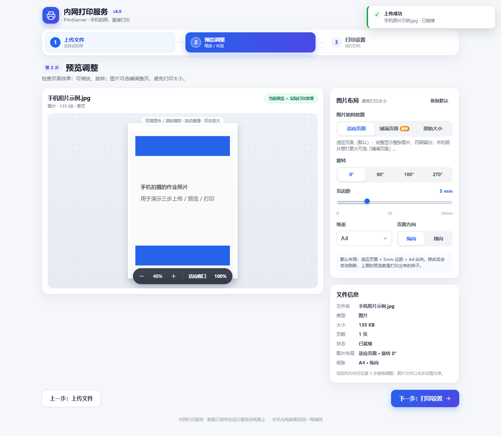
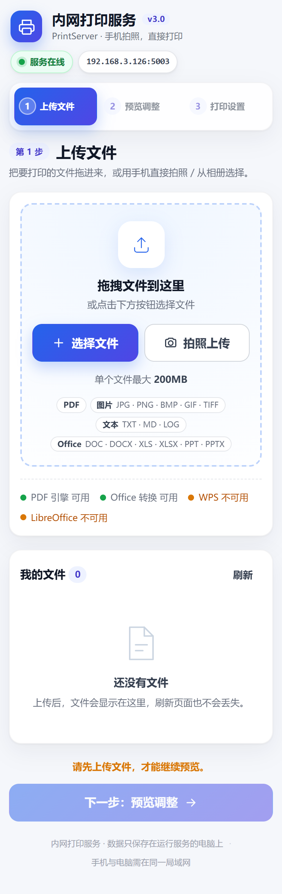
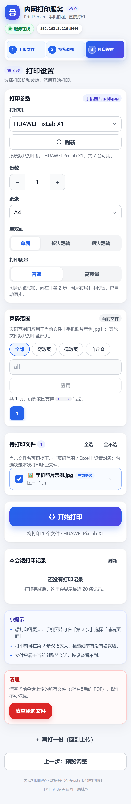

# 内网打印服务 PrintServer v3

[](LICENSE)
[](https://www.python.org/)
[]()

> 手机拍照 / 上传文件 → 网页预览调整 → 直接打印到连接这台 Windows 电脑的打印机。
> 完全静默打印、无需安装客户端，彻底绕开 Windows 共享打印机/驱动兼容性问题。

本项目基于开源项目 [Geekstrange/PrinterService](https://github.com/Geekstrange/PrinterService)（原始项目 [a937750307/lan-printing](https://github.com/a937750307/lan-printing)）反编译核对后重建并优化，v3 主要解决实际使用中的三个痛点：

| # | 问题 | v3 修复 |
|---|------|---------|
| 1 | 手机上传的图片网页里不能缩放，打印出来很小 | 三步向导第 2 步提供可缩放预览（滚轮/双指/拖动/按钮），图片支持 **适应页面 / 铺满页面 / 原始大小**、旋转、边距、纸张、方向；服务端按真实可打印区域铺满（去掉原版两处 10% 缩小），自动校正手机照片 EXIF 方向，预览即打印效果 |
| 2 | 打开网页能看到别人要打印的文件（隐私泄露） | 每个浏览器会话独立目录与权限校验，只能看到/打印/删除自己的文件与打印记录；局域网他人无法访问；仅服务器本机（localhost）为管理员视图，可查看全部会话 |
| 3 | 界面是工具面板式，引导性弱 | 全新手机优先响应式三步向导：**1 上传文件 → 2 预览调整 → 3 打印设置**，步骤条可回退、未解锁置灰并说明原因，每步有引导文案 |



## ✨ 功能特性

- 🖨️ **静默打印**：Windows GDI 直接打印，无任何弹窗；打印任务串行化，多人同时打印不会交错
- 📱 **手机优先**：同一局域网内手机/平板/电脑浏览器直接使用，支持拍照上传、双指缩放预览
- 🖼️ **图片所见即所得**：适应/铺满/原始大小、旋转、边距、纸张（A4/A5/Letter/4R/5R）、方向，预览即实际打印效果
- 📄 **多格式自动转 PDF**：PDF、图片（JPG/PNG/BMP/GIF/TIFF）、文本（TXT/MD/LOG）、Office（DOC/DOCX/XLS/XLSX/PPT/PPTX）
- 📑 **页码范围**：全部/奇数页/偶数页/自定义（`1-5, 7`），支持页码按钮点选
- 📊 **Excel 增强**：选择工作表、打印区域（`A1:F20`）或表格内拖拽框选
- ⚙️ **打印设置**：打印机、份数、单双面（真正通过 DEVMODE 生效）、纸张、方向、普通/高质量（150/300 DPI）
- 🔒 **会话隐私隔离**：每个浏览器会话只能看到自己的文件与记录；管理员可查看/清理全部
- 🧹 **自动清理**：上传文件与转换 PDF 默认 1 小时后自动删除（可配置）
- 🖥️ **托盘运行**：后台常驻，托盘菜单可打开管理页、显示手机访问二维码、开机自启
- 📴 **完全离线**：无 CDN、无外部网络请求

## 📸 界面预览

| 上传文件（手机） | 预览调整（手机） | 打印设置（手机） |
|---|---|---|
|  |  |  |

适应页面 vs 铺满页面对比（解决"打印太小"）：


## 🚀 快速开始

### 方式一：直接下载运行（推荐）

1. 到 [Releases](../../releases) 下载 `PrintServer.exe`；
2. 放到任意有写入权限的文件夹，双击运行（无主窗口，托盘出现蓝色打印机图标）；
3. 右键托盘图标 → 查看服务地址 / 手机访问二维码 / 开机自启；
4. 手机与电脑连同一局域网，浏览器访问服务地址（默认 `http://<电脑IP>:5000/`）。

> 首次运行如弹出 Windows 防火墙提示，请允许"专用网络"。

### 方式二：从源码运行

```powershell
git clone https://github.com/emltsj/PrinterService.git
cd PrinterService
python -m venv .venv
.venv\Scripts\python.exe -m pip install -r requirements.txt
.venv\Scripts\python.exe print_server.py --port 5000
```

### 打包单文件 exe

```powershell
powershell -ExecutionPolicy Bypass -File build.ps1
# 产物：dist\PrintServer.exe（约 45MB，单文件免安装）
```

## 🖥️ 环境要求

- Windows 10 / 11 x64，已连接可用的打印机（本地/网络/虚拟均可）
- Office 文档转换（任选其一即可）：
  - Microsoft Office（推荐，支持 Excel 打印区域）
  - [WPS Office](https://www.wps.cn/)（支持 Excel 打印区域）
  - [LibreOffice](https://www.libreoffice.org/)（免费备选，不支持打印区域）
- 图片/文本/PDF 转换与打印不依赖 Office

## 🧭 使用流程

1. **上传文件**：拖拽、点击选择、手机拍照、电脑 `Ctrl+V` 粘贴；自动转 PDF。
2. **预览调整**：页面预览可缩放（双指/滚轮/拖动/双击）；图片可选布局、旋转、边距、纸张与方向。
3. **打印设置**：选择打印机与参数、页码范围（Excel 可选工作表/区域），勾选文件后开始打印；结果与打印记录实时显示。

更详细的图文说明见 [docs/使用说明.md](docs/使用说明.md)。

## 🔒 隐私与安全

- 每个浏览器/设备拥有独立会话，文件与打印记录互相不可见；
- 只有运行服务的本机（`localhost`）是管理员，可查看所有会话文件并一键清理；
- 文件名安全清洗、归属校验、防路径穿越；
- 默认 200MB 单文件上限，文件 1 小时自动清理；
- 面向**可信局域网**设计（无登录、HTTP 明文），请勿直接暴露到公网。

## 🌐 HTTP API

完整接口契约见 [docs/UI-SPEC.md](docs/UI-SPEC.md)，主要接口：

| 方法 | 路径 | 说明 |
|---|---|---|
| GET | `/health` | 健康检查 |
| GET | `/api/session` | 会话/环境/打印机信息 |
| POST | `/upload` | 上传并转 PDF |
| GET | `/api/files` | 本会话文件列表（管理员 `/api/files/all` 看全部） |
| GET | `/api/render/<name>/<page>` | 页面 PNG（前端缩放预览） |
| GET | `/api/image_layout/<name>` | 按图片布局参数渲染打印效果 PNG |
| GET | `/api/page_count/<name>` | PDF 页数 |
| POST | `/print_single` / `/print_all` | 静默打印 |
| POST | `/delete_file` | 删除自己的文件 |
| GET | `/api/logs` | 本会话打印记录 |

## 🧪 测试

```powershell
# 后端 API / 隐私隔离 / 打印参数 / 图片版式（不产生真实打印）
.venv\Scripts\python.exe -m pytest tests -q
# 浏览器端到端（Edge headless，自动截图）
.venv\Scripts\python.exe tests\e2e_ui.py
```

当前结果：**pytest 162 passed / 0 failed；E2E 92/92 通过**（详见 [docs/TEST-REPORT.md](docs/TEST-REPORT.md)）。
打印链路通过 mock 与 GDI 设备上下文验证，未在 CI 中向真实打印机送纸。

## 📁 项目结构

```
├─ print_server.py          # 后端：Flask + 文件转换 + 静默打印 + 托盘
├─ static/                  # 前端（三步向导，原生 JS，无第三方依赖）
│  ├─ index.html
│  ├─ app.css
│  └─ app.js
├─ docs/                    # 接口契约、测试报告、使用说明、截图
├─ tests/                   # pytest 集成测试 + Playwright E2E
├─ scripts/make_icon.py     # 生成 exe 图标
├─ PrinterService.spec      # PyInstaller 打包配置
├─ requirements.txt
└─ build.ps1                # 一键打包
```

运行时会在工作目录生成 `uploads/`、`pdfs/`（按会话隔离）、`print_log.txt`、`server.log` 等。

## 📝 更新日志

见 [CHANGELOG.md](CHANGELOG.md)（相对原版的全部改动与额外修复）。

## 📄 许可证与致谢

本项目采用 [BSD 2-Clause](LICENSE) 许可证。

- 原始项目：[a937750307/lan-printing](https://github.com/a937750307/lan-printing)（BSD-2-Clause，Copyright (c) 2025 YiHengZhou）
- 重建基线：[Geekstrange/PrinterService](https://github.com/Geekstrange/PrinterService)
- v3 修改与新增代码：Copyright (c) 2026 emltsj，同样以 BSD-2-Clause 发布

免责声明：本软件按"现状"提供，使用前请确认打印机与文件内容安全；因打印结果或数据丢失造成的损失由使用者自行承担。
